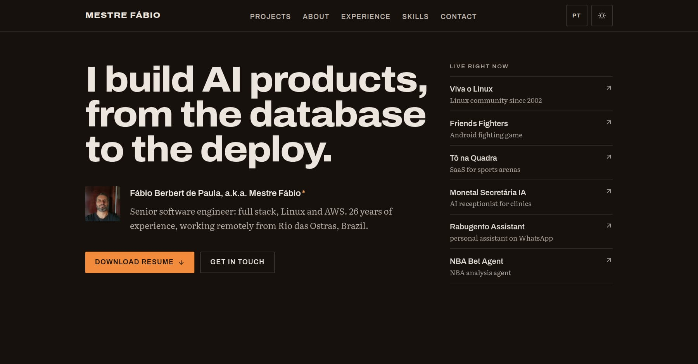
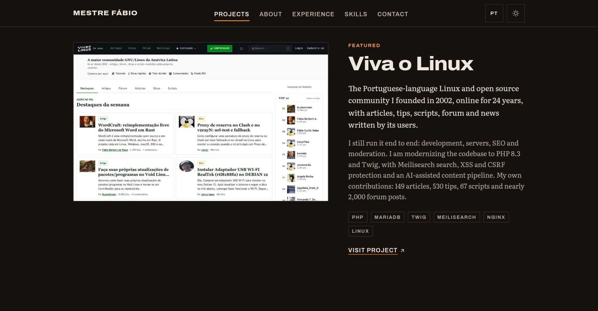
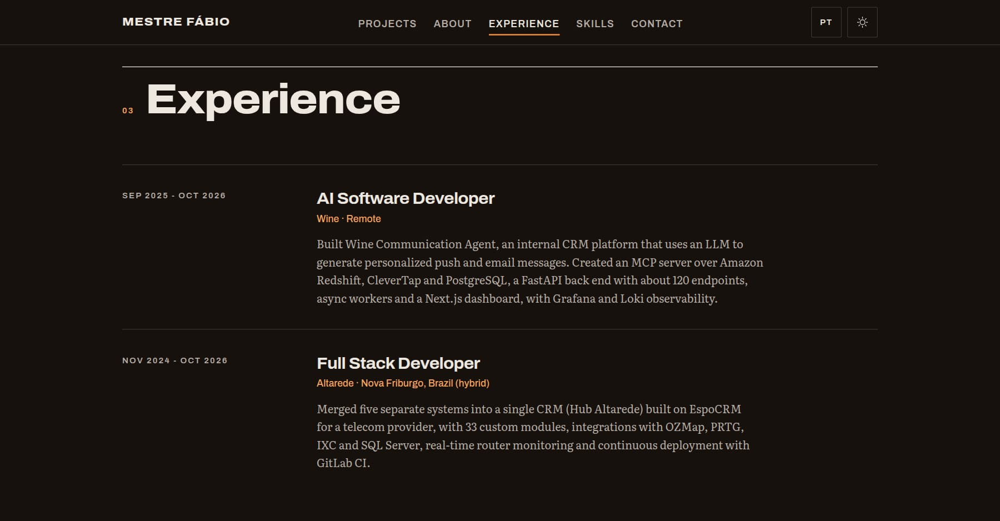
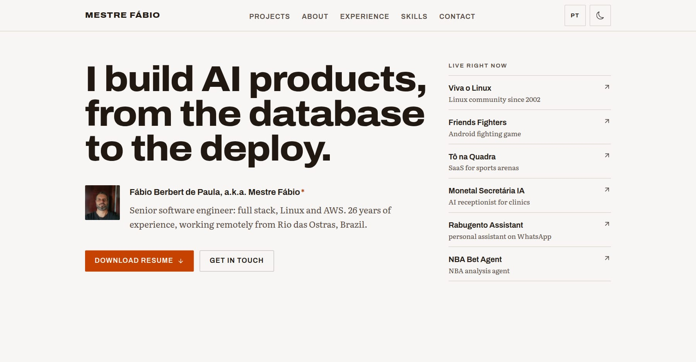

# mestrefabio.com

## About

This portfolio website is built with:
- Next.js 15 App Router and Server Actions
- A mix of Client and Server Components
- TypeScript
- Tailwind CSS with OKLCH design tokens (light and dark themes) in `app/globals.css`
- Archivo (display) and Literata (text) through `next/font`
- State management using Context API (language, theme, active section)
- Framer Motion reveals that respect the visitor's reduced-motion setting
- Email functionality through React Email & Resend
- Bilingual content (English and Brazilian Portuguese) in `lib/translations.ts`
- Responsive layout with a compact mobile menu

Design context and principles live in `.impeccable.md`.

You are welcome to clone, copy, and use this code for your projects.

Live demo here: [https://mestrefabio.com](https://mestrefabio.com)

## Screenshots

## Setup

Use Node **22.21.0**, pinned in `.nvmrc` and `.node-version`. With nvm, run `nvm install` and `nvm use`, then `npm ci`. Start development with `npm run dev`.

To set up this project for personal use, follow these steps:

1. Obtain an API key for email sending functionality at [Resend.com](https://resend.com).
2. Create a `.env.local` file in the root folder of your repository and add your RESEND_API_KEY.
3. Modify the "to" email address in the `sendEmail.ts` action file to your preferred email.

## Deploy

See [the deployment runbook](docs/deploy.md) for prerequisites, immutable releases, verification and rollback. The default command is `~/bin/build-mestrefabio`; `--check` validates the local snapshot without a remote connection.

## Reference

This repository draws inspiration from ByteGrad's portfolio project, available at: [https://github.com/ByteGrad/portfolio-website](https://github.com/ByteGrad/portfolio-website).

